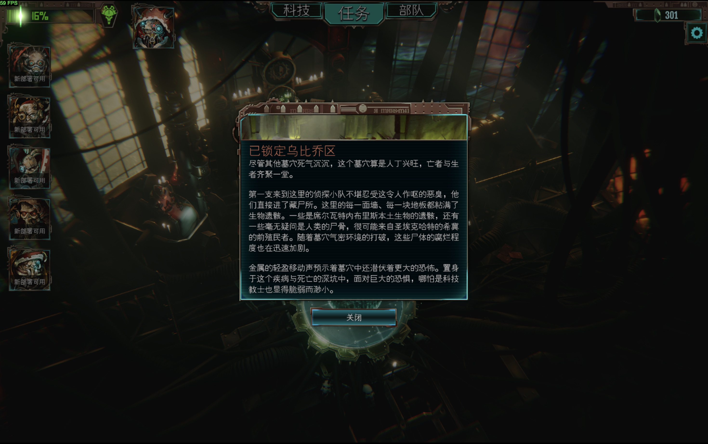
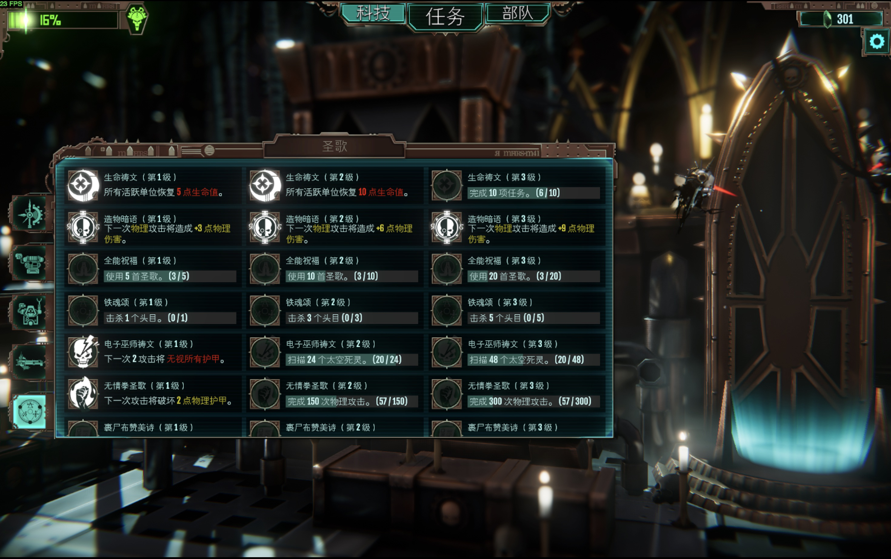

# Mechanicus Chinese text readability — visual demonstration

**Limited public showcase for review by the game's team and other players.**

While playing the original Warhammer 40,000: Mechanicus on macOS, I found Chinese
text too small to read comfortably and could not find a solution that addressed
the issue. I investigated it and developed a local readability patch.

This showcase contains screenshots, a high-level description and a
generic checksum example. The complete patch builder, versioned edit plan,
field values, binary offsets and implementation history are kept private.

## Original full-screen view

This equipment screen was captured after restoring the original font settings
for comparison. It is an original-font baseline, not an intermediate patch.


## Improved full-screen view

Same equipment screen, with the locally validated font and small-text improvements:


Both game sessions used fullscreen 2048 × 1280. The saved macOS captures are
2940 × 1912; the files have not been cropped, resized or enhanced. Browser
scaling affects the preview. The 3D animation and FPS counter differ between
captures.

The [earliest preserved original menu capture](evidence/original-menu-full.jpg)
was recorded before the first font patch. Its saved dimensions are 2940 × 1846.

## Detailed views

The four pairs below compare an intermediate Chinese-font-only improvement
with the validated second patch that also adjusts selected UI text components. Their
before images are not the original-font baseline shown above.

| Sample | Intermediate | Improved |
| --- | --- | --- |
| Equipment |  |  |
| Discipline |  |  |
| Canticle |  |  |
| Battle tooltip |  |  |

## Latest follow-up: larger text within the original outer frames

**11 October 2026, local revision V5:** follow-up work addresses small text in
troop details, sector introductions, canticle effects and unlock conditions,
ship upgrades, difficulty descriptions, load-list information and additional
UI labels. The sector introduction and troop title backgrounds have been
returned to their original outer dimensions. The new-game outer window and
button positions remain unchanged; internal text layout has been adjusted.

### Sector introduction

All three paragraphs and the final sentence fit within the original outer frame:



### Canticle effects and unlock conditions

Larger effect descriptions wrap within their cards; the list remains scrollable:



### More full-window evidence

| Sample | Latest capture and observation |
| --- | --- |
| Canticle list, lower portion | [Full window](evidence/canticles-effects-bottom-full.png): effects, unlock conditions and a detail card |
| Ship upgrade | [Full window](evidence/ship-upgrade-full.png): cognition-capacity tooltip |
| Casual difficulty | [Full window](evidence/difficulty-casual-final-full.png): long description fits above Other Settings |
| Very Hard difficulty | [Full window](evidence/difficulty-very-hard-final-full.png): description fits in the same outer window |
| Load list | [Full window](evidence/load-list-full.png): location, mission and awakening information |

These seven captures are unmodified 2940 × 1846 full-window images from the
Chinese game. They document the current result; they are not matched before/after
pairs. The load-list image includes a temporary test save used to replay a popup;
that test copy was subsequently removed from the game's save directory.
A replacement screenshot showing the latest troop text panel is still pending;
the archived V5 troop capture did not retain the visible tooltip.

## Scope and validation

The local fix addresses the Chinese font resource and selected UI text
components, including dynamically created battle tooltips and canticle cards.
Testing used the original game's macOS Steam version 1.4.11, build 14431362.
The earlier equipment comparison and detail crops above document the second
patch; the new captures document the later follow-up.

The latest revision adds 178 previously unmodified text-component targets and
revises four earlier text targets. These are serialized component counts,
including repeated UI instances, not 178 separately verified screens.

Local checks confirmed the intended field changes, unchanged bytes outside
targeted objects, installed-file hashes, and original outer-frame transforms
for the sector popup, two troop title backgrounds and the new-game dialog.
Six installer tests passed, covering apply/restore, running-game and unknown-file
refusal, and rollback after a simulated replacement failure. The complete
restore-to-original and reapply workflow was exercised. The 36 original save
files remained unchanged. These are locally reported checks; the limited public
showcase does not contain the implementation needed to reproduce them.

**Remaining validation:** not all combat, mission-result, permadeath, rename,
discipline-node or missing-equipment states have been exercised in the latest
revision. Other troop levels, sector texts, UI copies, languages, resolutions
and controller interactions also need broader testing. Further low-font-size
candidates remain under investigation; not every candidate is a visible defect.
This is not a claim that every small-text issue has been resolved.

Complete technical materials can be discussed privately with the game's team.

## Small code example: file verification

The following generic helper illustrates how a file digest can be checked.
It is not the patch builder and contains no game-specific edits or constants.

```python
import hashlib
from pathlib import Path


def file_sha256(path: Path) -> str:
    """Compute a digest without loading the whole file into memory."""
    digest = hashlib.sha256()
    with path.open("rb") as stream:
        for block in iter(lambda: stream.read(1024 * 1024), b""):
            digest.update(block)
    return digest.hexdigest()
```

## Status and rights

This is community review material, not an official update or endorsement.
Underlying game content shown in the screenshots belongs to its respective
rights holders. No extracted game assets, assemblies, fonts, saved games or
complete patch payloads are included.
Sharing screenshots or this limited example does not grant a license to the
private implementation. Contribution and integration terms can be discussed
with the contributor. Investigation and tooling used AI assistance and local
verification.
