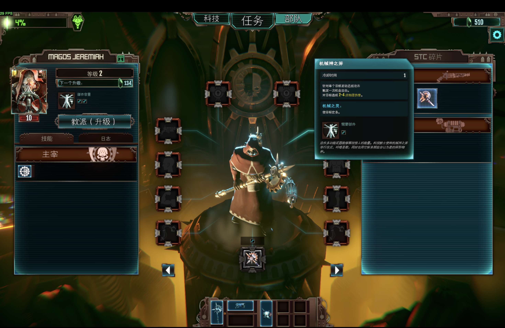
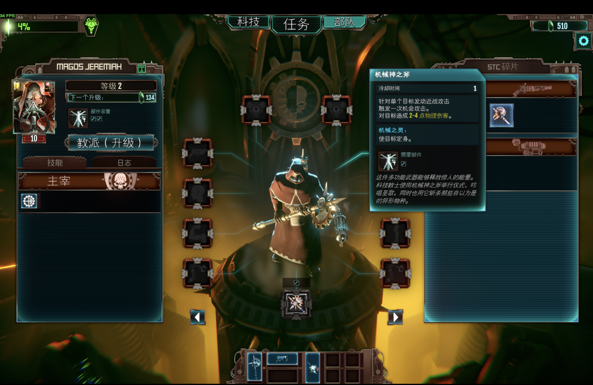
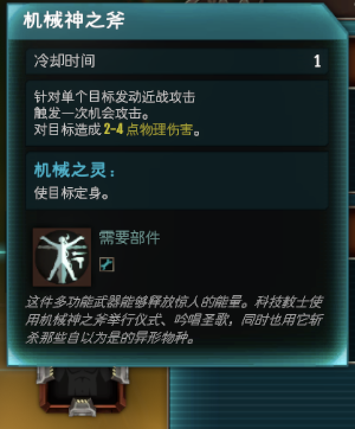
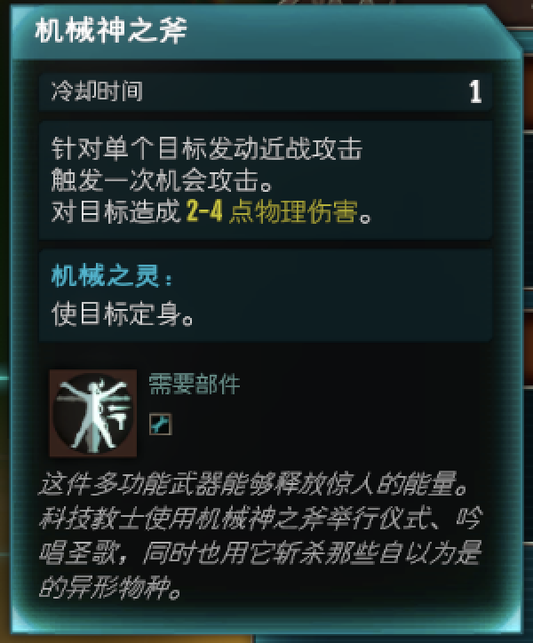
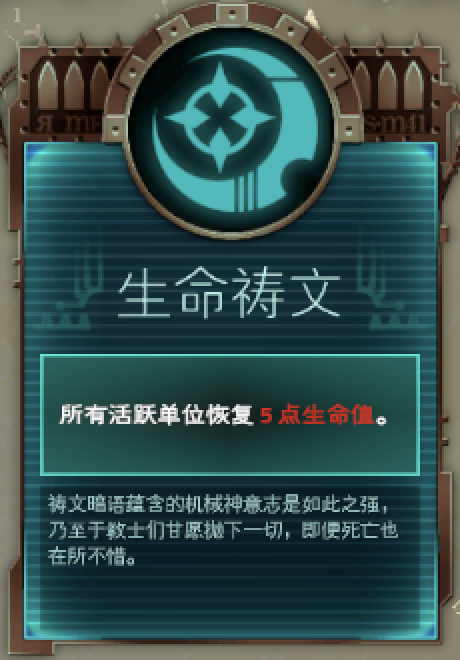
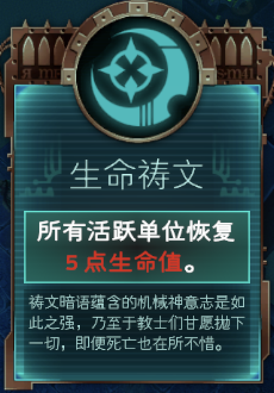
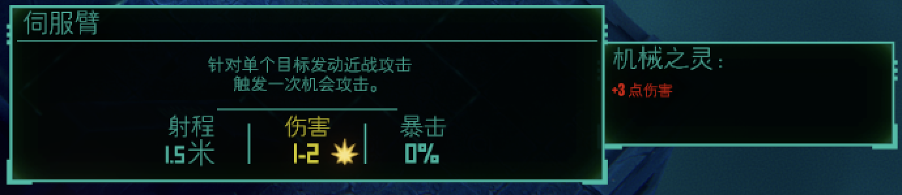
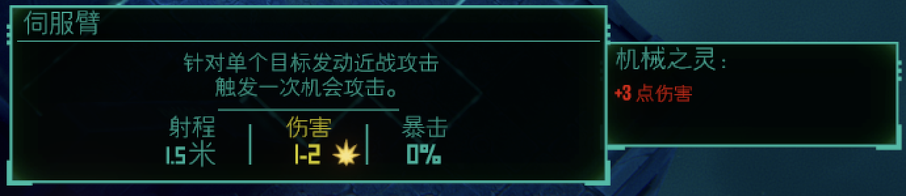

# Mechanicus Chinese text readability — visual demonstration

**Limited public showcase for review by the game's team and other players.**

While playing the original Warhammer 40,000: Mechanicus on macOS, I found Chinese
text too small to read comfortably and could not find a solution that addressed
the issue. I investigated it and developed a local readability patch.

This showcase contains screenshots, a high-level description and a
generic checksum example. The complete patch builder, versioned edit plan,
field values, binary offsets and implementation history are kept private.

## Original full-screen view

This equipment screen was captured after restoring the original font settings
for comparison. It is an original-font baseline, not an intermediate patch.



## Improved full-screen view

Same equipment screen, with the locally validated font and small-text improvements:



Both game sessions used fullscreen 2048 × 1280. The saved macOS captures are
2940 × 1912; the files have not been cropped, resized or enhanced. Browser
scaling affects the preview. The 3D animation and FPS counter differ between
captures.

The [earliest preserved original menu capture](evidence/original-menu-full.jpg)
was recorded before the first font patch. Its saved dimensions are 2940 × 1846.

## Detailed views

The four pairs below compare an intermediate Chinese-font-only improvement
with the validated second patch that also adjusts selected UI text components. Their
before images are not the original-font baseline shown above.

| Sample | Intermediate | Improved |
| --- | --- | --- |
| Equipment |  |  |
| Discipline |  |  |
| Canticle |  |  |
| Battle tooltip |  |  |

## Scope and validation

The local fix addresses the Chinese font resource and selected small-text
components, including dynamically created battle tooltips and canticle cards.
Previously recorded checks covered selected Chinese equipment, skills,
discipline, mission, battle and canticle screens. Full language, resolution,
controller and content coverage has not been established.

**Follow-up status (11 October 2026):** further use and a static UI audit found
remaining small text in troop details and other descriptions and labels.
Additional changes are being investigated; they are not included in the
validated screenshots above. This is an improvement for the sampled screens,
not a claim that every small-text issue has been resolved.

The private review tool passed nine tests and reproduced all seven previously
verified patch outputs exactly. Those results are reported here; this showcase
alone does not let readers independently rebuild the patch. Complete technical
materials can be discussed privately with the game's team.

## Small code example: file verification

The following generic helper illustrates how a file digest can be checked.
It is not the patch builder and contains no game-specific edits or constants.

```python
import hashlib
from pathlib import Path


def file_sha256(path: Path) -> str:
    """Compute a digest without loading the whole file into memory."""
    digest = hashlib.sha256()
    with path.open("rb") as stream:
        for block in iter(lambda: stream.read(1024 * 1024), b""):
            digest.update(block)
    return digest.hexdigest()
```

## Status and rights

This is community review material, not an official update or endorsement.
Underlying game content shown in the screenshots belongs to its respective
rights holders. No extracted game assets, assemblies, fonts, saved games or
complete patch payloads are included.
Sharing screenshots or this limited example does not grant a license to the
private implementation. Contribution and integration terms can be discussed
with the contributor. Investigation and tooling used AI assistance and local
verification.
